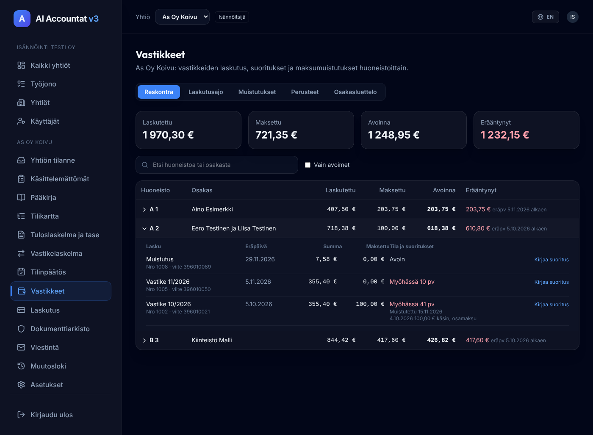
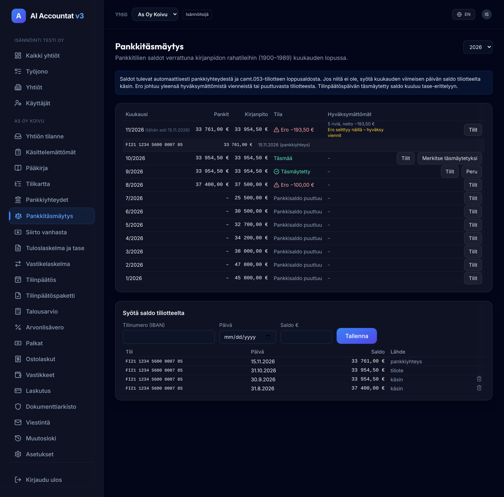
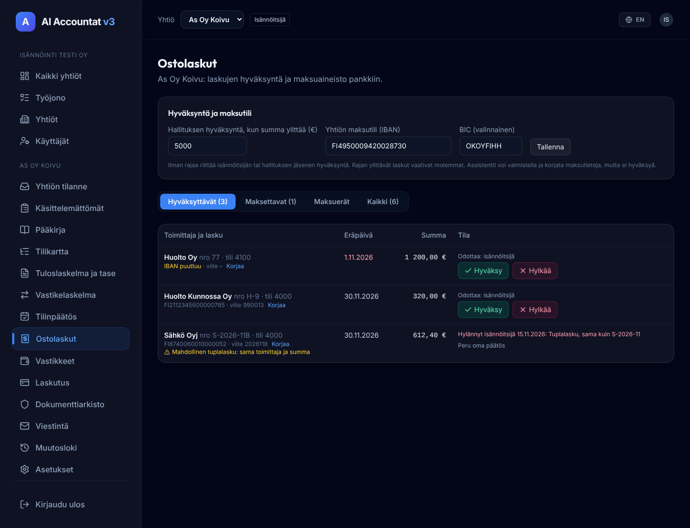
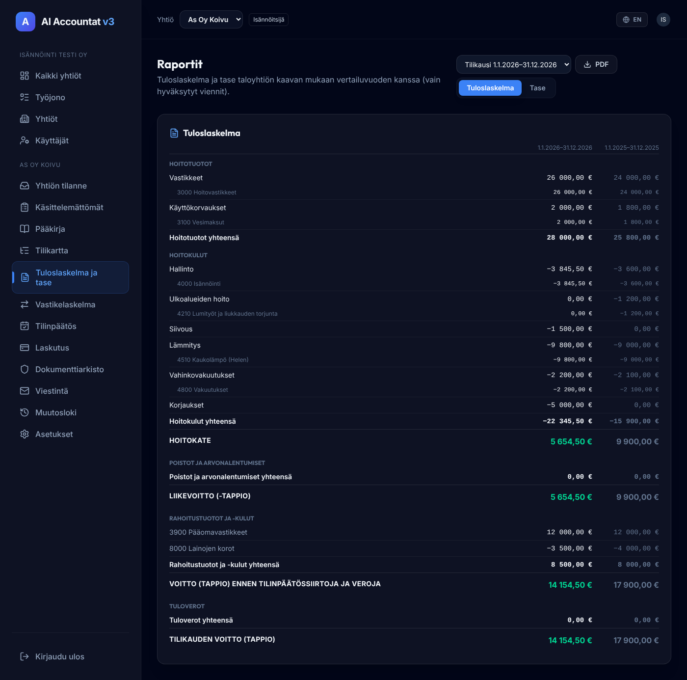

# Accounting Autopilot

**Kirjanpito- ja isännöintijärjestelmä suomalaisille taloyhtiöille ja isännöintitoimistoille.**
Pankkitapahtumat, vastikkeet, ostolaskut, palkat, arvonlisävero ja tilinpäätös samassa palvelussa.
Tekoäly lukee tositteet ja ehdottaa kirjaukset, ja ihminen hyväksyy ne.

*A bookkeeping and property-management platform for Finnish housing companies: bank feeds, maintenance-charge
ledger, purchase-invoice approval, payroll, VAT and year-end closing in one system, with AI-assisted voucher reading.*



## Mitä se tekee

Isännöintitoimisto hoitaa samalla tunnuksella kymmeniä taloyhtiöitä. Järjestelmä hoitaa kunkin yhtiön koko
kuukausikierron ja kokoaa poikkeukset yhteen työjonoon, joten ihmisen tarvitsee katsoa vain se, mikä ei
mennyt automaattisesti läpi.

| Alue | Sisältö |
|---|---|
| **Pankki** | PSD2-tilitiedot (Enable Banking), camt.053- ja CSV-tiliotteet, kuukausittainen pankkitäsmäytys |
| **Vastikkeet** | Laskutusajo, viitteet ja virtuaaliviivakoodi, suoritusten kohdistus, muistutukset, osakasluettelo |
| **Ostolaskut** | Tekoälyluku tositteesta, hyväksyntäkierto rajoineen, tuplalaskujen tunnistus, SEPA-maksuaineisto |
| **Kirjanpito** | Kahdenkertainen kirjanpito, taloyhtiön tilikartta ja raporttikaavat, pääkirja, muuttumaton muutosloki |
| **Verot ja palkat** | Arvonlisäveroilmoitus, palkkalaskenta, tulorekisteri-ilmoitukset, urakkatiedot |
| **Tilinpäätös** | Tuloslaskelma ja tase vertailuvuoden kanssa, vastikelaskelma, talousarvio, tilinpäätöspaketti PDF:nä ja sähköinen allekirjoitus |
| **Osakkaat** | Osakasportaali: omat vastikelaskut, maksutiedot ja viivakoodi |
| **Käyttöönotto** | Siirto vanhasta järjestelmästä (saldoluettelo ja tilikartan vastaavuudet) |

<table>
<tr>
<td></td>
<td></td>
</tr>
<tr>
<td align="center">Pankkitäsmäytys kuukausittain</td>
<td align="center">Ostolaskujen hyväksyntä ja tuplalaskun tunnistus</td>
</tr>
</table>



## Tekniikka

- **Frontend:** React, TypeScript, Vite, Tailwind CSS, TanStack Query, i18next (suomi ja englanti)
- **Backend:** Node.js ja Express (TypeScript), Prisma ja PostgreSQL. Palvelut on jaettu toimialueittain
  (käyttäjät, kirjanpito, tositteet, laskutus, pankki, dokumentit, ilmoitukset, muutosloki), mutta tuotannossa
  ne ajetaan yhtenä prosessina (`apps/server`), jotta pieni asennus pysyy yksinkertaisena.
- **Python-palvelut:** FastAPI. Tositteiden luku Clauden avulla (Anthropic API) ja PDF-raportit reportlabilla.
- **Tietoturva:** JWT-istunnot ja niiden mitätöinti, kirjautumisen lukitus, kaksivaiheinen tunnistus (TOTP),
  yhtiökohtaiset käyttöoikeudet ja ketjutettu muutosloki, jota ei voi muokata jälkikäteen.
- **Suomalaiset standardit:** viitenumerot, virtuaaliviivakoodi, Finvoice, camt.053, SEPA-maksuaineisto,
  tulorekisteri.
- **Testit:** yksikkötestit kriittisille laskennoille (ALV, palkat, tilinpäätös, täsmäytys, viitteet, muutosloki)
  ja vuosiajo-skripti, joka ajaa koko tilivuoden esimerkkiyhtiöllä alusta loppuun.
- **Asennus:** yksi skripti Ubuntu-palvelimelle: systemd, Caddy (automaattinen HTTPS), Docker-tietokanta ja
  päivittäiset varmuuskopiot. Katso [deploy/LUEMINUT.md](deploy/LUEMINUT.md).

## Kokeile paikallisesti

Windowsissa `KAYNNISTA.bat` käynnistää tietokannan ja palvelut. Esimerkkidatan saa komennolla:

```bash
npm install
npm run demo       # esimerkkiyhtiö, tiliotteet ja laskut
npm run vuosiajo   # koko tilivuosi läpi esimerkkiyhtiöllä
```

## Tila

Kehitysvaiheessa, ja pilottia valmistellaan. Kuvakaappausten tiedot ovat keksittyjä esimerkkejä.
